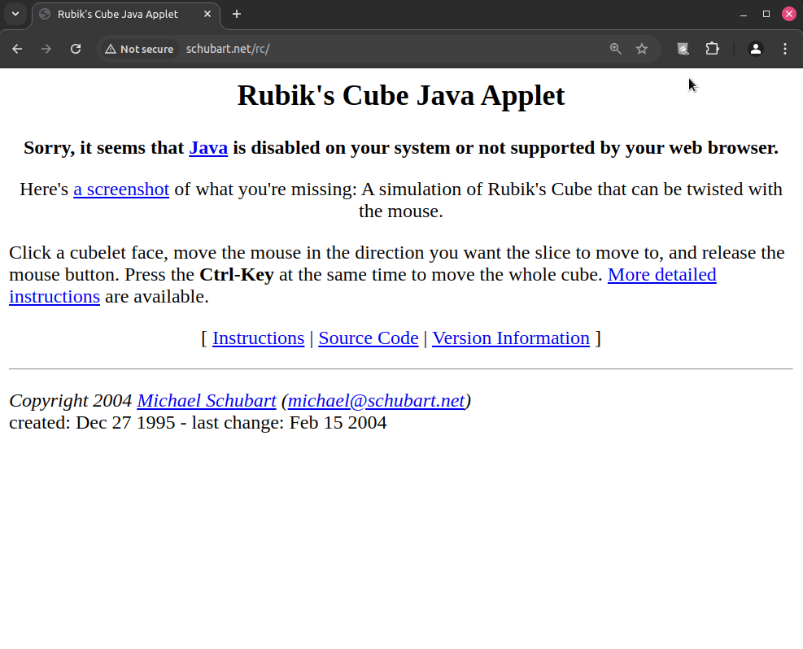

  
  

<h3 align="center">Run Java applets in modern browsers.</h3>

  The CheerpJ browser extension for applets, for Chrome and Edge. 
  No Java plug-in and no Java installed on the computer.

  <b><a href="https://chromewebstore.google.com/detail/cheerpj-applet-runner/bbmolahhldcbngedljfadjlognfaaein">Add to Chrome</a></b> ·
  <b><a href="https://microsoftedge.microsoft.com/addons/detail/cheerpj-applet-runner/ebfcpaoldmijengghefpohddmfpndmic">Add to Edge</a></b> ·
  <a href="https://labs.leaningtech.com/cheerpj-applet-runner">Docs</a> ·
  <a href="https://discord.leaningtech.com">Discord</a> ·
  <a href="https://github.com/leaningtech/cheerpj-applet-runner/issues/new/choose">Report a bug</a>

The extension runs Java applets in place, on the pages where they have always been. It is listed as **CheerpJ Applet Runner** in the Chrome Web Store and Edge Add-ons. It is built on [CheerpJ](https://cheerpj.com), a Java runtime built from OpenJDK and compiled to WebAssembly, and the CheerpJ browser extensions have more than 170,000 users together.

> [!NOTE]
> This repository is the extension's public **issue tracker**. The extension's code isn't here. For a Java Web Start (`.jnlp`) application, use the [extension for Java Web Start](https://github.com/leaningtech/cheerpj-jnlp-runner).

## How to use it

1. Install the extension from the [Chrome Web Store](https://chromewebstore.google.com/detail/cheerpj-applet-runner/bbmolahhldcbngedljfadjlognfaaein) or [Edge Add-ons](https://microsoftedge.microsoft.com/addons/detail/cheerpj-applet-runner/ebfcpaoldmijengghefpohddmfpndmic), and pin it to the toolbar.
2. Open a page with an applet, click the extension's icon and press **Enable**.
3. The applet starts. The extension stays on for that site, so its applets start by themselves next time.

See [using the extension for the first time](https://labs.leaningtech.com/docs/cheerpj-applet-runner/getting-started/using-first-time).

## What it runs

| | |
| --- | --- |
| **Java** | Java 8 applets, with Swing and AWT interfaces |
| **Browsers** | Chrome, Edge and other Chromium browsers on desktop |
| **Files** | Upload files from a button in the applet's title bar; files the applet saves arrive as browser downloads ([file handling](https://labs.leaningtech.com/docs/cheerpj-applet-runner/guides/file-handling)) |
| **Also** | Networking, audio, printing and the clipboard, through the browser |

For an applet on a page you control, you can also [add CheerpJ to the page](https://cheerpj.com/java-applets/) so visitors need no extension.

## For organisations

With an Enterprise licence, desktop administrators deploy the extension to managed Chrome and Edge through Group Policy or Intune, and set the licence by policy, where it activates offline. A self-hosted version serves networks that can't reach the stores, including air-gapped ones. See [enterprise configuration](https://labs.leaningtech.com/docs/cheerpj-applet-runner/guides/configure-extension-for-enterprises) and [private hosting](https://labs.leaningtech.com/docs/cheerpj-applet-runner/guides/private-hosting-for-enterprises).

## Privacy

The applets, their data and their traffic stay between your browser and their servers, and don't pass through us. If you activate a licence, the extension checks it with our licence server. It collects no usage statistics. The details are in the [privacy policy](https://cheerpj.com/privacy-policy-for-cheerpj-applet-runner-browser-extension/).

## Reporting a bug

Use **Report a bug** in the extension's menu, or [open an issue](https://github.com/leaningtech/cheerpj-applet-runner/issues/new/choose). Include:

- the address of the page with the applet, if it's public;
- the extension's version, from `chrome://extensions` or `edge://extensions`;
- your browser and OS;
- the full console output, from the browser's developer tools.

Issues are public. For an applet on an internal or private site, write to appletrunner@leaningtech.com instead. Questions are welcome on [Discord](https://discord.leaningtech.com).

## Licensing

Free for personal use and technical evaluation. Business use needs a [Desktop licence](https://cheerpj.com/licensing/#run), bought online for up to 20 desktops. For larger deployments, Enterprise licences need no licence server: [contact us](https://cheerpj.com/contact/). See [the extension's licences](https://cheerpj.com/cheerpj-applet-runner-licenses/).

---

  <a href="https://cheerpj.com/extensions/">cheerpj.com</a> ·
  <a href="https://discord.leaningtech.com">Discord</a> ·
  <a href="https://x.com/leaningtech">X</a> ·
  Made by <a href="https://leaningtech.com">Leaning Technologies</a>

